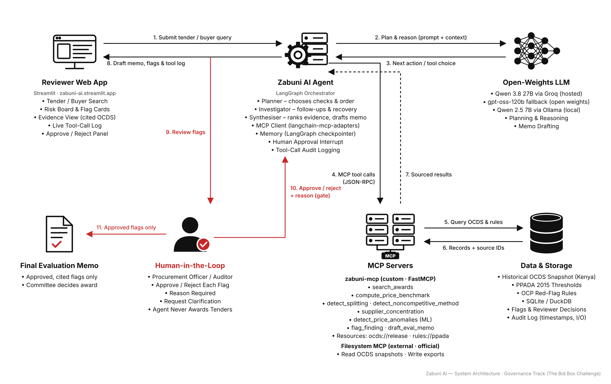

# Zabuni AI: architecture (one page)



> **v1.1 (summit refinement, tag `v1.1-summit`).** This page describes the system as submitted (`v1.0-submission`) plus the v1.1 changes, each marked **(v1.1)**: untrusted-data handling, server-side boundaries, per-provider progressive disclosure, OpenTelemetry traces and a decision-memory resource. Measurements: `EVALS.md` sections 6-7.

**What it is.** An agentic *decision-support* tool. A reviewer names a buyer, a supplier or years; a LangGraph agent plans an investigation of published Kenyan tender awards (PPRA, Open Contracting Data Standard), calls tools **only through MCP**, and raises flags that each cite their OCDS record. A human approves, rejects or queries every flag with a reason; only approved flags enter the evaluation memo. **The agent never recommends or awards a tender.**

## Agent design
```
request ─► PLANNER ─(scope guard)─► INVESTIGATOR ⟲ ─► SYNTHESISER ─► HUMAN GATE ⟷ CLARIFY ─► MEMO
```
* **Planner** (1 LLM call; **v1.1: 2 calls on Ollama**, see below): builds a structured plan from the tool catalogue discovered with `list_tools` (no tool name is hard-coded). **(v1.1) Progressive disclosure, per provider:** where enabled (Ollama on, Groq off, because it measured worse there) the first call shows a one-line-per-tool index and returns the tools needed and the scope found; the second shows full arguments for the chosen tools only. Any unusable choice falls back to the full catalogue. The scope it extracts is *grounded* in the request text; a request with no buyer, supplier or period ends here with a question.
* **Investigator** (loops on a conditional edge): runs one step per visit, then follows declarative follow-up rules (a price outlier triggers splitting and concentration checks), widens a search that found too few comparables, and gives a failing call one LLM correction. Stops at a tool-call or token budget and says so.
* **Synthesiser** (1 LLM call; **v1.1: gives up after 2 malformed attempts and the tools' own wording is used, without asking the fallback model**): ranks and words the flags the *tools* proposed. A citation guard drops any finding that mentions an ocid no tool returned; checks on the same award are merged into one card; a flagged award outside the requested scope is dropped; at most 10 flags per run.
* **Human gate:** a LangGraph `interrupt` saved by a SQLite checkpointer. Approve / reject / clarify per flag, a reason required, the reviewer recorded by *role*. Clarify re-investigates that flag and pauses again; a rejected flag is remembered and not raised again.
* **Memo:** drafted from approved flags only, saved through the Filesystem MCP server.

## Custom vs borrowed MCP servers
| Server | Why |
|---|---|
| **`zabuni-mcp`** (custom, FastMCP, stdio): 6 analysis tools (`search_awards`, `compute_price_benchmark`, `detect_splitting`, `detect_noncompetitive_method`, `supplier_concentration`, `detect_price_anomalies`), 5 write/review tools (`flag_finding`, `record_decision`, `attach_clarification`, `list_flags`, `draft_eval_memo`), resources `ocds://release/{ocid}`, `rules://ppada` and, **(v1.1)**, the read-only `decisions://run/{run_id}` and `decisions://flag/{flag_id}` (reviewer role, decision, reason, time, cited ocids) | The domain logic (red-flag rules, thresholds, citations, the flag store) is ours and must be testable, bounded and cited. Every result carries `evidence: [{ocid, award_id, field, value}]`; every threshold lives in `rules.py`. |
| **Filesystem MCP** (official `@modelcontextprotocol/server-filesystem`, pinned, sandboxed to `outputs/`) | File I/O and path sandboxing are solved, widely used code; the agent gets a capability-limited way to save memos, and every write is an audited MCP call. We do not hand-roll file permissions. |

**(v1.1) Write boundary:** only `flag_finding`, `record_decision`, `attach_clarification` and `draft_eval_memo` (`rules.py` `boundaries.write_tools`) may open the flags database for writing; the check is where the database is opened, every other tool is refused, and the analysis database is read-only with SQL file access off. Input limits (name, text, list length, years, rows) are enforced inside the tools from `rules.py`.

The planner sees only read-only tools without a role; the write/review tools carry a *role* in their metadata and are called only by the gate, so the model cannot approve its own flags.

## Data flow
UI/CLI → `open_session` (MCP client, rules, audit log, LLM chain, checkpointer) → graph → MCP tools → read-only `data/zabuni.duckdb` (frozen PPRA snapshot of 8 Oct 2026) and the writable `flags.duckdb` (flags, decisions, clarifications, memos). Every tool call, agent decision and LLM call is logged (`logs/*.jsonl`) with tokens and estimated cost. **(v1.1)** The same facts are also written as OpenTelemetry spans (run -> LLM call -> tool call, with tokens, cost, duration, provider, model and fallback) to `logs/traces.jsonl`; `python -m agent.traces` prints them as a tree. **(v1.1) Untrusted data:** every string from the OCDS data is scrubbed, length-capped, quarantined if it reads like an instruction, and delimited with a per-run id before any model sees it; the memo, cards and CLI show data text as inert text.

## Failure handling
| Failure | Response |
|---|---|
| No scope / a scope the model invented | `ground_scope` + scope guard: ask, run nothing (the "hello → 40 flags" case, `evals/intentional_failure.md`) |
| Run too long or too costly | tool-call and token budget in `rules.py`, carried across run and review; the memo states the stop |
| Groq 429 / daily quota | backoff → second open-weights model → clean stop; a per-minute limit is never mistaken for the daily one |
| Model returns unusable output | next model for that call only |
| MCP server dies | restart once and retry; a clear error in the log |
| Bad tool arguments | schema check before the call, unknown arguments dropped, one LLM correction |
| Hallucinated ocid | citation guard + `flag_finding` re-checks every cited award exists |
| **(v1.1)** Instruction hidden in a name or title | quarantined in the model's view, delimited as data, echoed text replaced by the tools' wording, a model "correction" cannot redirect a call to another buyer or supplier; nothing is approved except by a human |
| **(v1.1)** Synthesiser returns unusable output | gives up after 2 malformed attempts; flags keep the tools' own wording; the fallback model's quota is not spent |
| **(v1.1)** A read tool tries to write | refused where the flags database is opened; an error envelope, nothing created |

## Deliberately left out
No automated decision, scoring or ranking of tenders or suppliers; no personal data (company names only); no bid documents (not published); no live data (frozen snapshot); no ML beyond one Isolation Forest outlier check (fixed seed); no second-level approval in the product (designed and verified as a practice requirement); **(v1.1) no Streamable HTTP transport and no explicit UNKNOWN status for timed-out tool calls (future work)**; no validated thresholds yet (all labelled *provisional* until a practitioner session).
