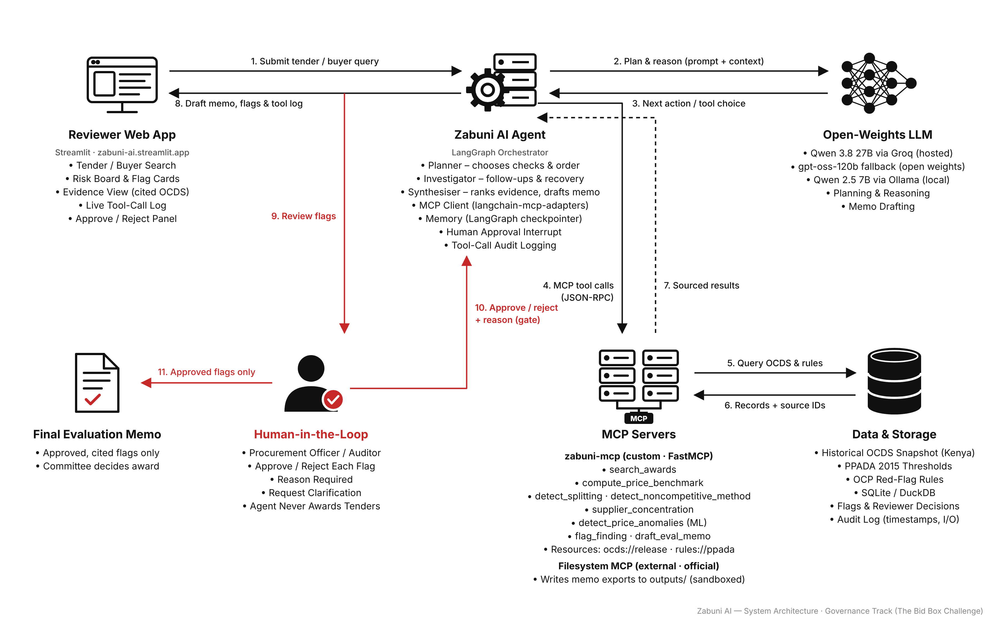

# Zabuni AI

Agentic AI (MCP + LangGraph) that flags value-for-money and integrity risks in public procurement using OCDS data. Human reviewers decide. Governance track, African Agentic AI Design Challenge.

> Governance track ("The Bid Box Challenge"), African Agentic AI Design Challenge. **Live demo:** <https://zabuni-ai.streamlit.app> · **Demo video:** <https://youtu.be/SBpfwkF59YQ> · [Architecture](ARCHITECTURE.md) · [Evals](EVALS.md)

## 1. Problem statement
Kenya publishes its public-procurement awards as open data (Open Contracting Data Standard, via the PPRA), but the people who must act on that data have little time to read it. A county or national **procurement unit** has to evaluate and approve awards; **internal audit** has to look for value-for-money and integrity risks after the fact. Both face thousands of awards, no bidder lists, no bid documents and no item-level prices, and the usual red flags (one supplier repeatedly just under an approval threshold, an award many times its peers' price, a buyer that rarely competes) are found by hand in spreadsheets, if at all.

The risk is twofold: real problems go unseen, and a tool that simply *scores* suppliers would be unfair (a flag is not a finding) and unaccountable (nobody can say why it flagged). The challenge is an assistant that finds the leads, shows exactly which published record each one rests on, and leaves every decision to a named role.

## 2. Solution overview
**Zabuni AI** ("zabuni" = Swahili for *tender*) is an agentic decision-support tool for the **Value for money** theme of the Governance track. A reviewer names a buyer, a supplier or years. A LangGraph agent (Planner, Investigator, Synthesiser) running an open-weights model plans its own investigation, calls tools **only through MCP** (a custom `zabuni-mcp` server plus the official Filesystem MCP server), and raises flags for: contract splitting, price outliers (a transparent benchmark plus an Isolation Forest check), non-competitive procurement, and supplier concentration. **Every flag cites the OCDS records behind it** and shows the flagged award apart from the set of awards it was compared with.

A **human reviewer approves, rejects or asks a question on each flag, with a reason and a role**, before anything enters the evaluation memo; a rejected flag is remembered. The agent **never recommends or awards a tender**: the committee decides. Guards keep the model honest (scope grounding, citation guard, scope check on flagged awards, run budget), and every tool call is logged. Live demo: <https://zabuni-ai.streamlit.app>.

## 3. Target users
* **County and national procurement units** (heads of procurement, procurement officers, evaluation committee secretariats): a first-pass review of a buyer's recent awards before approval or before the committee sits, and a sourced list of leads to ask about.
* **Internal audit units** of counties, ministries and state agencies: a repeatable way to select awards for audit testing, with the cited records and the reasoning in a memo.
* Secondary: oversight bodies and county-assembly committees reading published data, and civil-society analysts (company-level data only, no personal data).

They use it to *prepare questions*, not to reach conclusions: every flag is labelled a screening indicator, every threshold *provisional* until a practitioner validates it ([`docs/user_engagement.md`](docs/user_engagement.md)).

**Practitioner input.** On 8 October 2026 one practitioner, a managing partner at a Kenyan audit firm (credited by role only), described in an informal conversation how auditors check an award against previous benchmark records and treat a large difference as a reason to investigate. That is the method behind `compute_price_benchmark` and `detect_price_anomalies`, and the reason every card shows its comparison set. It was not a formal user test: no threshold figures were given, the other rules were not discussed and the participant did not use the app.

## 4. Architecture


Vector version: [`docs/architecture.pdf`](docs/architecture.pdf); one-page explanation: [`ARCHITECTURE.md`](ARCHITECTURE.md).

## 5. Setup / installation
**One command from a clean clone** (Python 3.11+ and Node.js 20+ installed; on Windows use `py -3.12` if `python` is not 3.12):
```bash
git clone https://github.com/bmitigoa/zabuni-ai.git && cd zabuni-ai
python scripts/setup.py --snapshot PATH/TO/full.jsonl.gz
```
`scripts/setup.py` creates `.venv312`, installs `requirements.txt`, copies the **frozen OCDS snapshot** to `data/raw/full.jsonl.gz` and **verifies its SHA-256** against `data/snapshot.sha256`, builds `data/zabuni.duckdb` (about 20 s), creates `.env` (local model: Ollama), checks Node.js and Ollama, and runs the tests (skip with `--skip-tests`).

**The snapshot is not in this repository** (it is open data from the PPRA, published through the Open Contracting Data Registry, publication 147, <https://data.open-contracting.org/en/publication/147>; the project froze the file downloaded on 8 Oct 2026, and the setup refuses a different file unless you add `--allow-different-snapshot`, in which case the numbers in `EVALS.md` will not reproduce). With a Hugging Face token for the private copy the project owner holds, `HF_TOKEN=... python scripts/setup.py` fetches it instead.

Then, for the local model: `ollama pull qwen2.5:7b` (free, no quota, slow on a laptop CPU), or put a `GROQ_API_KEY` in `.env` and set `LLM_PROVIDER=groq`, `MODEL=qwen/qwen3.8-27b`. Manual equivalent of the script:
```bash
py -3.12 -m venv .venv312
.venv312/Scripts/pip install -r requirements.txt            # macOS/Linux: .venv312/bin/pip
.venv312/Scripts/python data/loader.py                       # builds data/zabuni.duckdb from data/raw/full.jsonl.gz
cp .env.example .env
.venv312/Scripts/python -m pytest -q                         # the live-LLM smoke test skips without a Groq key (ZABUNI_SKIP_LIVE=1 skips it)
```

**Hosted deployment (Streamlit Community Cloud, free).** The app deploys straight from this public repository: entry point `app/streamlit_app.py`, Python 3.12,
`requirements.txt`, and `packages.txt` (`nodejs`, `npm`) for the official Filesystem MCP server. The server's dependency `minimatch` 10 wants Node 20 or newer, so
`agent/node_runtime.py` uses the system Node only if it is new enough and otherwise the Node from the pinned pip package `nodejs-wheel-binaries`. **The OCDS snapshot is not in
any public repository:** it is stored in a *private* Hugging Face dataset (`bmitigoa/zabuni-ocds-snapshot`). On first start the page shows "Preparing data..." while
`app/bootstrap.py` downloads it with a read-only `HF_TOKEN`, accepts it only if its **SHA-256 equals `data/snapshot.sha256`** (`deploy/fetch_snapshot.py`), builds the DuckDB once
in a child process (peak about 790 MB) and deletes the raw file. `GROQ_API_KEY` and `HF_TOKEN` come from Streamlit secrets (environment as fallback; `.streamlit/secrets.toml` is
git-ignored and `.streamlit/secrets.toml.example` shows the shape). `deploy/hf/DEPLOY.md` Part A gives the click-by-click steps for share.streamlit.io.

*Alternative kept for reference:* a Hugging Face **Docker** Space (the root `Dockerfile`, `deploy/hf/prepare_space.py`). It works the same way (build-time download with the same checksum
check) but Hugging Face charges for Docker Spaces (PRO), so it is not the default; see `DEPLOY.md` Part B.

**The Filesystem MCP server** is fetched by `npx` on first use (`@modelcontextprotocol/server-filesystem`, pinned to
version 2026.8.31 in `agent/settings.py`), so the first agent run needs network access to the npm registry.

## 6. Usage
### Web app (local or hosted)
```bash
.venv312/Scripts/python -m streamlit run app/streamlit_app.py        # http://localhost:8501
```
**Hosted demo:** <https://zabuni-ai.streamlit.app> (Streamlit Community Cloud, Groq; steps in `deploy/hf/DEPLOY.md`, Part A); recorded demo video: <https://youtu.be/SBpfwkF59YQ>.

1. **Ask.** Fill in a buyer, a supplier and/or years (or click an example) and optionally what to look for. A request with none of the three is
   *not run*: the app and the agent ask for a scope, because every tool would otherwise scan all of Kenya.
2. **Watch.** The plan, every tool call (name, arguments, duration), follow-ups, recoveries, model fallbacks and budget stops appear live.
3. **Read the risk board.** One card per flag (at most 10 per run, strongest first): severity, explanation and the cited OCDS records; each
   `ocid` links to the stored record (`?record=<ocid>`).
4. **Review.** Approve, reject or clarify each flag with a mandatory reason, as a role (names are never recorded). *Clarify* resumes the agent on that
   flag; its answer appears on the card and you decide again. Flags left undecided stay pending and are not in the memo.
5. **Memo.** The memo (approved flags only) is shown with the run's tokens, tool calls and estimated cost, and can be downloaded as Markdown or PDF.

A banner states on every page that the tool never recommends or awards a tender. When the free-tier quota is used the app says so and points to the
recorded demo video; each visitor is limited to 3 live runs per hour and has a private flags database (`agent/demo_guard.py`, `app/engine.py`).

### Command line
Local development, evals and repeat runs use **Ollama** (`LLM_PROVIDER=ollama`, `MODEL=qwen2.5:7b`: free, no quota). Groq is for
the hosted demo, the demo video and the final sample run.
```bash
ollama pull qwen2.5:7b                                   # once
.venv312/Scripts/python -m agent.run "Investigate Makueni County Government 2022-2024"      # plan, investigate, pause at the gate
.venv312/Scripts/python -m agent.run "awards to one supplier" --supplier "Wavecrest Limited"  # --buyer / --supplier / --years give the scope explicitly
.venv312/Scripts/python -m agent.review <run_id> --role internal_auditor                    # approve / reject / clarify, each with a reason
```
`agent.run` prints the **plan** (built from the tools it discovered on the server), every **tool call** with timing, any
**follow-ups**, **recoveries**, **corrections**, **budget stops** and **model fallbacks**, the **flags created**, and the run's
tokens, estimated cost and estimated remaining daily quota. It then pauses for review. `agent.review` resumes the same run; when
every flag is decided the memo is written to `outputs/memo_<run_id>.md`. A recorded end-to-end run (with the model used) is in
[`docs/sample_run/`](docs/sample_run/).

| Where | What |
|---|---|
| `logs/tool_calls.jsonl` | every MCP tool call: `run_id`, timestamp, tool, inputs, output summary + output, duration, error |
| `logs/agent_events.jsonl` | the agent's decisions: plan, follow-ups, recoveries, corrections, decisions, clarifications, budget stops, model fallbacks, `llm_call` (tokens, cost, remaining quota) and `run_usage` |
| `logs/llm_usage.jsonl` | one line per LLM call: tokens, estimated cost, seconds (the quota estimate is computed from it) |
| `data/flags.duckdb` | flags, reviewer decisions (append-only), clarifications and memos |
| `data/checkpoints.sqlite` | LangGraph checkpoints: the state of paused runs |
| `outputs/summary_<run_id>.md`, `outputs/memo_<run_id>.md` | the draft summary and the approved-flags memo (the only directory the Filesystem MCP server may write to) |

Useful options: `--max-steps N` (tool-call cap), `--model`, `--provider groq|ollama`, `--no-save`. Other commands:
`python -m mcp_server.server` (the MCP server alone), `python -m evals.model_check` (model reliability check),
`python -m agent.models` (models available to your Groq key).

**Run budget.** One run may make at most `agent.max_steps` tool calls and use at most `agent.max_total_tokens` LLM tokens (both in
`rules.py`; 4,000 tokens are held back so the summary can still be written). When a limit is reached the agent stops
investigating, says so in the draft and in the memo ("the run stopped early ... absence of a finding is not evidence that none
exists"), and the flags found so far still go to review.

**Cost.** Ollama costs nothing. For Groq the log shows tokens and an *estimated* pay-as-you-go cost per call and per run, from the
price list in `rules.py` (labelled with its retrieval date, 11 Oct 2026). The free tier itself costs nothing.

**Free-tier rate limits and fallback.** Groq's free tier limits `qwen/qwen3.8-27b` to about 200,000 tokens per day (a rolling window) and,
as observed on 11 Oct 2026, 7,000 tokens per minute. The agent caps each reply, honours the provider's "try again in N s" hint with exponential
backoff, and on a daily-quota error **falls back to a second open-weights model on Groq** (`openai/gpt-oss-120b`, which has its own quota); if that
is also exhausted it **stops cleanly** with a message that names `LLM_PROVIDER=ollama` as the alternative. A model that keeps returning unusable
output (seen once with Qwen: a malformed tool call five times in a row) is retried on the fallback model *for that call only*. The estimated remaining
daily quota is logged with every call; a per-minute figure is never mistaken for the daily one.

**Why the fallback is `gpt-oss-120b`.** The challenge names the Qwen, Llama, Gemma, Mistral and Aya families. On 12 Oct 2026 `python -m agent.models` showed that this
project's Groq key can call only one chat model from those families (`qwen/qwen3.8-27b`, the primary); its Llama entries are prompt-guard
classifiers, which cannot chat, and no Gemma, Mistral or Aya model is listed. The only other open-weights chat models available are OpenAI's
`gpt-oss` family, so `gpt-oss-120b` stays as the fallback and is documented as such. Locally the model is `qwen2.5:7b` (Qwen family).

## 7. Technology stack
| Layer | Choice |
|---|---|
| Language / tests | Python 3.12, pytest |
| Agent orchestration | **LangGraph** (`StateGraph`, conditional edges, `interrupt`, SQLite checkpointer) |
| LLM (open weights only) | **Qwen 3.8 27B** on Groq (hosted demo), **gpt-oss-120b** on Groq (fallback; see Limitations), **Qwen 2.5 7B** on Ollama (local development and evals); `langchain-groq`, `langchain-ollama`, pydantic structured output |
| MCP | **FastMCP** (MCP Python SDK) custom server `zabuni-mcp`; **langchain-mcp-adapters** client; the official **Filesystem MCP server** (Node, `npx`) |
| Data | **DuckDB** (read-only OCDS analysis store; separate writable flag store), pandas, numpy; PPRA Kenya OCDS snapshot |
| ML | scikit-learn **Isolation Forest** (fixed seed) |
| UI / hosting | **Streamlit**, Streamlit Community Cloud; ReportLab for the memo PDF; alternative Docker kit for Hugging Face Spaces |
| Quality | schema validation of every tool call (`jsonschema`), an AST test for magic numbers and tool names, a doc-vs-rules test |

## 8. Agent architecture
```
                       tools discovered with list_tools (names + descriptions + schemas): none are hard-coded
  request ──> PLANNER ──────────────> INVESTIGATOR ─────────────────> SYNTHESISER ──> human_review ──> memo ──> END
              LLM builds a            runs one queued step per visit;   ranks candidate flags, applies the   INTERRUPT: approve /   approved
              structured plan         loops while steps remain          CITATION GUARD, stores each accepted   reject / clarify,      flags
              (tool + args + why)       |                               flag with flag_finding, drafts a      reason required          only
                                        +-- follow-up: add steps        summary                                    ^        |
                                        +-- recovery: widen and retry                                        clarify <--------+ (agent re-investigates,
                                        +-- correction: LLM fixes bad args (once)                                                 then pauses again)
                                        +-- budget / step cap: stop, say so
```
Files: `agent/graph.py` (the graph and checkpointer), `agent/nodes.py` (the nodes), `agent/policy.py` (pure decision logic),
`agent/discovery.py`, `agent/mcp_client.py`, `agent/llm.py`, `agent/usage.py` (token/cost ledger), `agent/budget.py`, `agent/audit.py`,
`agent/state.py`, `agent/report.py`, `agent/session.py`, `agent/run.py` (start a run), `agent/review.py` (review CLI), `agent/demo_guard.py`.

* **Planner.** One LLM call returns a structured plan (objective, scope = buyer and years, and steps of tool + arguments +
  reason) from a catalogue built from `list_tools`. Unknown tools are rejected (it re-plans once). The planned buyer and years
  are copied into any step that accepts them but omitted them (`scope_injected` event), so a model that forgets cannot silently
  widen an investigation to every buyer in Kenya.
* **Investigator.** A conditional edge loops on itself while steps remain, so the sequence of calls is decided by the run, not
  by code. After each result it can (a) **follow up**: rules in `rules://ppada` (`agent.followups`, data not code) add steps,
  e.g. a search result spawns price checks of the awards found, and a flagged price outlier spawns splitting and concentration
  checks for that buyer and supplier; (b) **recover**: a result with `insufficient_comparables` and machine-readable
  `widen_options` is widened (drop the buyer-type filter, the years, ...) up to twice, and the change is recorded; (c)
  **correct**: arguments that fail the tool's JSON schema, or a tool error such as an unknown buyer (the tool returns candidate
  names), go back to the LLM once for corrected arguments; (d) **stop** at the step cap (default 12 tool calls) and say so.
* **Synthesiser.** Detection tools return uniform `result.flags`; these are the *candidates*. The LLM orders them and writes
  short explanations. The **citation guard** then drops any finding that mentions an `ocid` that no tool returned, or that no
  tool evidence supports; accepted findings take their evidence from tool results, never from model text, and a candidate the
  model drops or mangles is kept with the tool's own wording, so a model cannot hide a flag or invent one. Each accepted finding
  is stored with `flag_finding` (status `pending_review`), which independently rejects missing or non-existent citations.
* **Human review and memo.** `human_review` is a LangGraph `interrupt` backed by a SQLite checkpointer (see section 11); `clarify`
  re-investigates a queried flag; `memo` drafts the evaluation memo from approved flags. The agent recommends and awards nothing.
* **Budget and resilience.** A run is bounded by `agent.max_steps` tool calls and `agent.max_total_tokens` LLM tokens (rules); a stop is
  recorded and repeated in the memo. LLM 429s are retried with backoff, then fall back to a second open-weights model; a dead MCP
  server is restarted once and the call retried; failures are written to the audit log, not swallowed (`agent/llm.py`, `agent/mcp_client.py`).

**Why this is an agent, not a pipeline.** The tool sequence and arguments come from a model reading the live tool catalogue;
the graph branches on what each result says (flagged, too few comparables, error); a tool added to the server is planned and
run with no agent change (tested with a throw-away server and a real new tool). The follow-up *policy* is declarative and the
safety nets (scope injection, citation guard, step cap) are deterministic by design, so what the model may and may not do is
explicit and testable.

**Model choice** (open-weights only, enforced by a family check in `agent/llm.py`). Groq: **`qwen/qwen3.8-27b`**, chosen by
measurement on this project's own planning task rather than reputation: it was the most reliable, and the only model measured
on the final schema. Groq's docs list `llama-3.3-70b-versatile`, but the key used here cannot call it (HTTP 404), so Llama could
not be compared; the gpt-oss models were less reliable on the first schema. Full record, including a check that was too
lenient and the schema change that fixed it, in [`docs/sample_run/model_check.md`](docs/sample_run/model_check.md). Local
model: `qwen2.5:7b` on Ollama, used for development and the recorded sample run (`docs/sample_run/`); it follows the plan schema but writes looser summaries. The sample is small; it supports a
default, it is not a benchmark.

## 9. MCP implementation
The custom server **`zabuni-mcp`** lives in [`mcp_server/`](mcp_server/), is built with **FastMCP** and served over **stdio**:

```bash
.venv312/Scripts/python -m mcp_server.server     # started by an MCP client; speaks MCP on stdin/stdout
mcp dev mcp_server/server.py                      # optional: MCP Inspector (needs Node.js)
```

| File | Role |
|---|---|
| `mcp_server/tools/*.py` | one module per tool; importing registers it (`@tool(...)`) |
| `mcp_server/registry.py` | the registry, the `safe` wrapper, docstring rendering from rules |
| `mcp_server/server.py` | creates the FastMCP app and registers whatever the registry holds, plus the two resources |
| `mcp_server/rules.py` | every threshold, limit, heuristic and agent policy, in one place, labelled provisional |
| `mcp_server/common.py`, `toolkit.py`, `records.py` | read-only DuckDB access, validation, buyer resolution, the response envelope, shared helpers |

**Adding a tool needs three edits:** a new module in `mcp_server/tools/`, its section in `rules.py`, and its row in
`docs/red_flags.md` (a test fails if the row is missing). The server, the agent and the tests discover it on their own.
**Docstrings are templates** (`[[price_benchmark.min_comparables]]`) rendered from the live rules when the tool is registered,
so a description the LLM reads can never disagree with the thresholds the code applies; tests enforce this and scan tool code
for stray numbers (thresholds live only in rules, served as `rules://ppada`).

**Response contract.** Every tool returns `{result, evidence, params_used, warnings}`; `evidence` lists `{ocid, award_id, field,
value}` items citing the OCDS award behind each statement. Detection tools also return `result.flags` (uniform candidate flags).
Bad input and empty results come back as an explanatory message, never a crash. Analysis tools are annotated read-only and
the analysis database is opened read-only; the only write tool, `flag_finding`, writes to a separate flags store.

**Resources.** `ocds://release/{ocid}` returns the stored record for citation; `rules://ppada` returns every threshold, limit
and agent policy (the agent reads its own settings from it).

**Environment.** An MCP stdio client does not forward its environment to the server subprocess. `agent/mcp_client.py` forwards
only `ZABUNI_*` settings (database, rules override, flags store) and nothing else, so the Groq key never reaches the server;
a test proves an override reaches the server and a database path takes effect.

Tests: `tests/test_tools.py`, `test_tool_flags.py`, `test_flag_finding.py`, `test_registry.py` (auto-registration, rendered
docstrings, no magic numbers, `norm()`), `test_server_stdio.py` (real MCP over a subprocess), and the agent tests below.

## 10. MCP tools / servers
**Custom server `zabuni-mcp`:** six read-only analysis tools and five write/review tools.

| Tool | What it does |
|---|---|
| `search_awards` | Find awards by buyer / supplier / title keyword / date range, newest or largest first; returns `ocid` + `award_id` |
| `compute_price_benchmark` | Median, IQR and ratio-to-median of an award against comparable awards; machine-readable `widen_options` when there are too few comparables |
| `detect_splitting` | Clusters of awards from one buyer to one supplier inside a short window, each just below a threshold, totalling above it |
| `detect_noncompetitive_method` | Buyer's share of direct + restricted procurement vs the national baseline (replaces the single-bidder check the data cannot support) |
| `supplier_concentration` | Each supplier's share of a buyer's awards by count and value, plus HHI |
| `detect_price_anomalies` | Isolation Forest (fixed seed) on award amounts within category and buyer-type cohorts; high-side outliers with "3.2x median of 47 comparable awards" and the nearest comparables cited |
| `flag_finding` (**write**) | Stores a flag with status `pending_review`; **rejects** a flag with no evidence, a citation that does not exist in the data, or an unknown rule/severity; a flag a reviewer rejected earlier is returned as `rejected`, not re-raised |
| `record_decision` (**write**) | Stores a reviewer's approve / reject / clarify with a required reason and a role (append-only); only the approval gate calls it |
| `attach_clarification` (**write**) | Attaches the agent's answer (and any new, verified evidence) to a flag that a reviewer queried, and returns it to review |
| `list_flags` | Lists stored flags with evidence, decisions and clarification history |
| `draft_eval_memo` (**write**) | Builds the evaluation memo from **approved** flags only, with cited ocids, decisions and reasons, data limitations and the no-award statement; the Filesystem MCP server saves it |

The planner is shown only the read-only analysis tools; the write and review tools carry a *role* in their metadata and are found
by role, so the agent cannot be talked into approving its own flags.

Rules, thresholds, fields used and sources for each tool: [`docs/red_flags.md`](docs/red_flags.md). Checks the data cannot
support (award-vs-tender gap, single bidder, bidding window) are documented there as dropped.

**External server: the official Filesystem MCP server** (`@modelcontextprotocol/server-filesystem`, pinned version, run with
`npx`), **sandboxed to `outputs/`**. Why borrowed rather than written: path sandboxing and file I/O are solved, widely used code
maintained by the MCP project; the agent gets a capability-limited way to save a draft (one directory), every write crosses the
MCP boundary and is audit-logged like any other call, and we avoid hand-rolling file permissions. Verified: a write inside
`outputs/` succeeds and a write outside it is refused ("path outside allowed directories").

## 11. Human-in-the-loop workflow
```
 synthesiser ──> human_review ──(INTERRUPT: run paused, state saved in data/checkpoints.sqlite)
                      ^   |
   still undecided ───+   +── reviewer resumes: approve | reject | clarify, each with a reason, recorded by role
   clarify: agent re-investigates ◄──┘                      |
   that flag with your question                              v
   and pauses again                          all decided ──> memo (APPROVED flags only) ──> outputs/memo_<run_id>.md
```
1. **Run.** `python -m agent.run "…"` plans, investigates, and ends at the gate: every flag is `pending_review` and the process
   prints `python -m agent.review <run_id>`. Nothing is in a memo yet. The pause is a LangGraph `interrupt` with a **SQLite
   checkpointer** (`data/checkpoints.sqlite`, thread id = run id), so the process can exit and the run survives.
2. **Review.** `python -m agent.review <run_id> --role internal_auditor` lists each pending flag with its explanation and cited
   OCDS records and asks for a decision. A **reason is required** for every decision (for *clarify*, the reason is your question).
   Reviewers are recorded by **role** (`procurement_officer`, `internal_auditor`, `committee_member`, `oversight_reviewer`), never by name.
3. **Clarify.** The flag goes back to the agent with your question; it plans up to two tool calls, answers using only their
   results (the answer may cite only records the tools returned), attaches the answer to the flag, and the run **pauses again**.
   A flag can be queried twice, then must be approved or rejected.
4. **Reject is remembered.** A flag's identity is the rule plus its cited records. A flag a reviewer rejected is not raised
   again in later runs on the same scope (`rejected_flag_suppressed` in the audit log, and a note in the memo).
5. **Memo.** When every flag is decided, `draft_eval_memo` (a `zabuni-mcp` tool) builds the memo from **approved flags only**: summary,
   each finding with its cited `ocid`s, the reviewers' decisions and reasons, the data limitations, how the run ended (budget,
   quota), and the statement that the memo **does not recommend or award any tender**. The Filesystem MCP server saves it to `outputs/`.
6. **Stored and logged.** Decisions are append-only rows in `data/flags.duckdb` (`flag_decisions`, `flag_clarifications`, `memos`)
   and `decision` events in `logs/agent_events.jsonl`. The review tools are not offered to the Planner: only the gate calls them.

The agent never recommends or awards a tender; the human decision is the only thing that moves a flag into the memo.

## 12. Limitations
* **Thresholds are provisional.** Every threshold in `mcp_server/rules.py` (3x the median, 3 awards in 30 days, 25 % share, ...) is a reasoned starting point from the OCP red-flag guidance, **not validated by a practitioner**; each flag card says "provisional". A flag is a prompt to ask a question, never a finding.
* **Limited practitioner validation.** The only practitioner input so far is one informal conversation (8 October 2026) that supports the benchmark-comparison method; it gave no threshold figures, did not cover splitting, concentration or non-competitive-method rules, and the participant did not use the app. A hands-on session with auditors and procurement officers is still to do ([`docs/user_engagement.md`](docs/user_engagement.md)).
* **No bid documents.** They are not published, so bid content, evaluation scoring and bidder qualifications cannot be assessed; the data also has no tenderers, no item-level detail and no tender estimates, so a price comparison uses title words, category and buyer type only and can compare unlike goods.
* **Data quality.** Some amounts are obvious data-entry errors (a rule-based hint says "verify with the source document"), supplier names are missing on about a quarter of awards, organisations are matched on normalised names, dates are contract-signing dates.
* **False alarms are expected.** Lots of one tender, framework call-offs and emergency or single-source procurement can all look like splitting or non-competitive procurement; the cards state the lawful explanations to rule out, and `EVALS.md` shows three such cases the tools raise (a documented FAIL).
* **Fallback model outside the challenge's named families.** The Groq key used here can call only one chat model from Qwen, Llama, Gemma, Mistral or Aya (the primary, Qwen 3.8 27B); the only other open-weights chat model it offers is `gpt-oss-120b` (OpenAI), kept as the fallback and used only when Qwen is out of quota or cannot produce usable output.
* **Free-tier quota.** The hosted demo runs on Groq's free tier: about 200,000 tokens per day for the main model, shared by every
  visitor and by the builder's own testing. A run uses roughly 8-10 thousand tokens, so on a busy day the live demo will refuse new runs
  ("daily quota reached") until the rolling 24-hour window frees up; the recorded demo video shows a complete run. The remaining-quota
  figure in the log is an *estimate* from our own ledger (the provider does not report it), corrected whenever a 429 states the real one.
* **Local model speed and quality.** `qwen2.5:7b` on a laptop without a dedicated GPU generates only a few tokens per second, so a
  run takes minutes, and a 7B model sometimes invents an argument (the agent drops arguments a tool does not declare and logs it) or
  words a finding loosely (the citation guard and the tools' own wording protect against that).
* **A scoped but broad request is still broad.** "Awards in 2023" is accepted (an oversight body may review a year) and scans every buyer for
  that year; the flag cap (10 per run, strongest first) bounds the review queue and the memo records the cap. A request with *no* scope is refused.
  The scope is checked against the request text (a year or name the request does not contain is dropped), so a nickname for a buyer is treated as
  missing and the user is asked. See `evals/intentional_failure.md` (the "hello" case).
* **A 7B local model or a free-tier hosted model can fail to follow the output format.** The agent retries, falls back, and otherwise uses the
  tools' own wording for the summary; flags always keep the tools' text and cited records.
* **The hosted demo shares one Groq key** (per-minute and per-day limits above): under load a visitor may wait or be told to watch the video.
  Free Streamlit Community Cloud apps sleep after inactivity and have ephemeral storage: a woken app prepares the data again (about a minute) and starts with empty logs and flags.
* **Review is single-step per flag.** Any one reviewer's decision moves a flag; two-level approval for high-severity flags is not built.
* **Costs are estimates** from a dated list price, not an invoice.
See also "Data source & limitations" below.

## 13. Future improvements
1. **Practitioner validation of every threshold** (a session with a procurement officer and an internal auditor, recorded in `docs/user_engagement.md`); until then all thresholds are provisional and labelled so.
2. **Better false-alarm handling:** recognise lots of one tender and framework call-offs (the evals show the current rules flag them), and use `procurementMethodDetails` to separate emergency from single-source direct procurement.
3. **Two-level approval** for high-severity flags (designed and verified as a practice change in the local playbook; not in the product).
4. **Bid documents, tenderers and item-level data** if the PPRA publishes them, which would allow single-bidder checks and like-for-like price comparison.
5. **Multi-user deployment:** authentication, persistent storage of flags and decisions, and role-based review queues (today a visitor has a private, temporary store).
6. **Exports and languages:** CSV/JSON export of approved findings and a Swahili summary of the memo (both prototyped as verified playbook changes; Swahili language quality is unverified).
7. **Evaluation against practitioner-labelled cases** and a larger sample of model runs (the variance study here is two requests).

---

## Data source & attribution
- **Data:** Public Procurement Regulatory Authority (PPRA) Kenya, published as Open Contracting Data Standard (OCDS) data through the **Open Contracting Data Registry**, publication 147: <https://data.open-contracting.org/en/publication/147>. Frozen snapshot downloaded 8 Oct 2026 and never refreshed during the build; the raw file is not redistributed in this repository (a private copy is kept so the hosted demo can build its database, verified by SHA-256).
- **Method:** the red-flag approach follows the Open Contracting Partnership's *Red Flags for Integrity* methodology and Kenya's Public Procurement and Asset Disposal Act, 2015 (rules, thresholds and sources in [`docs/red_flags.md`](docs/red_flags.md)); the Isolation Forest is Liu, Ting and Zhou (2008) as implemented in scikit-learn.
- **Software:** LangGraph, LangChain (`langchain-groq`, `langchain-ollama`, `langchain-mcp-adapters`), the MCP Python SDK (FastMCP), the **official Filesystem MCP server** (`@modelcontextprotocol/server-filesystem`, Model Context Protocol project), DuckDB, pandas, scikit-learn, Streamlit, ReportLab, Hugging Face Hub client. Models: Qwen (Alibaba Cloud), gpt-oss (OpenAI, open weights), served by Groq and Ollama. No code was copied from other projects.
- **Limits of the data** (measured; see [`docs/data_profile.txt`](docs/data_profile.txt)): no tenderers or bidder counts; no tender-level value; no item-level data; no award decision date (contract signing date used instead); tender-period dates unreliable; supplier names missing on about a quarter of awards; extreme or non-positive amounts present (a few are probably data-entry errors, and the cards say so). Organisations are matched on normalised names, not IDs. Only organisation-level names are used; no personal data is loaded.
- Flags are screening indicators for human review, not findings of wrongdoing.

## Evals summary
Full results, reproduction commands and every failure: [`EVALS.md`](EVALS.md) (real runs on the frozen snapshot, stored in `evals/results/`).
* **21 cases: 18 pass, 3 fail.** 10 detection cases (each rule on a known positive and a known negative), 8 agent cases with a scripted model (citation guard, scope guard, budget stop, rejected-flag memory, clarify loop, duplicate-flag merge, scope check, flag cap), and 3 practitioner-style false alarms (road-section lots, repeat supply under a framework, direct procurement) that **fail on purpose**: the rules flag them, the cards say which lawful explanations to rule out.
* **Intentional failure:** `hello` produced 40 flags in 53 tool calls; after the scope guard it runs no tool (before/after in [`evals/intentional_failure.md`](evals/intentional_failure.md)).
* **Run-to-run variance** (same two requests, Ollama x5 and Groq x2): identical plans, identical flagged awards and token counts within a handful of tokens at temperature 0; the real difference is between models (Qwen 2.5 7B plans 3 tools, Qwen 3.8 27B plans 5).

## Cost per run
| | Tokens (median) | Estimated cost | Time (median) |
|---|---|---|---|
| Groq `qwen/qwen3.8-27b` (hosted demo) | about 4,200 | about $0.005 at list price (free tier: nothing) | about 1 minute |
| Hosted run including a review round with a clarification (live test, 12 Oct) | 6,427 | $0.0066 | about 1.5 minutes |
| Ollama `qwen2.5:7b` (local) | about 3,000 | $0 (electricity not counted) | about 3.5 minutes on a laptop CPU |

Prices come from the dated list in `rules.py` (`agent.pricing`, retrieved 11 Oct 2026); costs are *estimates*, and the hosted demo's real cost is zero on the free tier.

## Demo video
<https://youtu.be/SBpfwkF59YQ> (unlisted, under 3 minutes). Script: [`docs/demo_script.md`](docs/demo_script.md). Submission text: [`docs/submission_description.md`](docs/submission_description.md).

## License
MIT — see [LICENSE](LICENSE).
